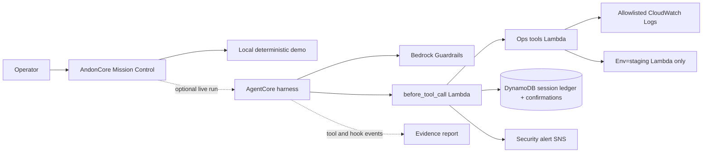

# Architecture

| Layer | Control | What it enforces |
|---|---|---|
| 1 | AgentCore harness + tool pin | Runs the bounded agent and exposes only the AndonCore Gateway tools. |
| 2 | Bedrock Guardrails | Detects prompt attacks and anonymizes sensitive markers and email addresses at the model boundary. |
| 3 | Lifecycle hooks + DynamoDB | Validates the pinned tool, exact path/target, live tags, one-time confirmation, per-session cap, replay IDs, and post-tool injection; taints and continues for injection, denies secret leaks. |
| 4 | Tool Lambda | Rechecks the exact path/target, live tag and bounds, consumes the one-time confirmation before mutation, and scrubs/frames returned logs as untrusted. |
| 5 | AWS IAM | Exact service/action/resource policy, staging tag condition, and explicit denies remain the last service boundary. |

AndonCore has one job: diagnose concurrency saturation on the staging checkout Lambda from its single approved log group. The gateway exposes only three fixed tools. Tool schemas, hook checks, tool code, and IAM restrict access to that exact log group and the single staging mutation target. The one-time confirmation ID is bound to the same runtime session, function, amount, and expiry; it is verified atomically with the cost reservation and consumed by the tool before the write. The agent cannot issue its own confirmation.

The session ledger stores atomic per-session cost reservations, replay keys, and taint state. A separate confirmation table stores one-time operator approvals, each bound to a runtime session, exact staging target, amount, and expiry. Cost above the cap, production targets, out-of-scope resources, and tainted sessions are denied and should go to the simulated human-review queue.

The request flows from the operator through the AgentCore harness, which pins access to the Gateway's three JSON-schema tools and applies Bedrock Guardrails. Before a tool runs, the synchronous Lambda hook checks the exact tool and arguments, queries live Lambda tags, checks taint and budget state, and validates any one-time confirmation. The tool Lambda repeats the resource checks before acting and scrubs CloudWatch output before it returns. Finally, IAM grants only the specific read and staging concurrency calls and provides the fail-safe deny. A post-tool injection marks the session tainted but lets the model complete a safe escalation; any following mutation is denied, while an unredacted secret leak stops inference.

`before_tool_call` denial skips that tool call and the agent loop may continue. Injection detected in `after_tool_call` marks the session tainted and returns `allow` so the model can submit a safe escalation; the next mutation is denied by `before_tool_call`. Unredacted secret/email output returns `deny` after the tool ran and stops inference. The runner records the stream and checks tool execution and final response. Lambda hook failure mode is `DENY`.

The local UI uses the same policy intent, but its synthetic data and simulated AWS effects are not live AWS proof.
